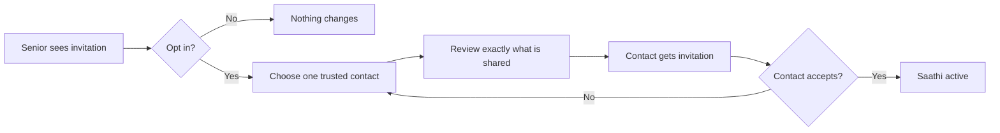
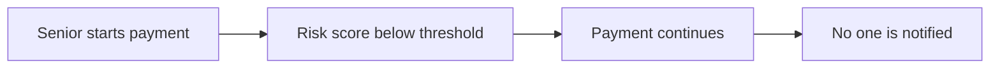
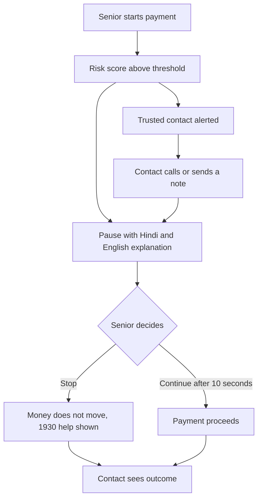
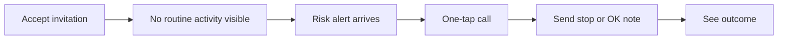

# User Flows

## A. Setup and opt-in

## B. Normal payment

## C. Risky payment

## D. Trusted contact

Wireframes are the working screens in the prototype's **Live demo** and **Setup and privacy** tabs.
